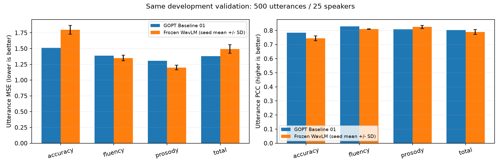
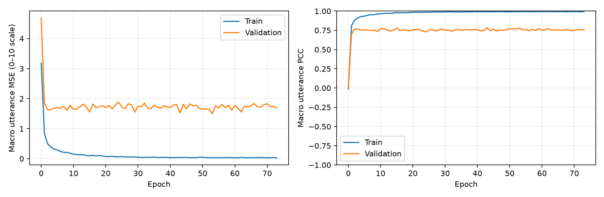

# Phase 2 — Frozen WavLM 실험 기록

2026-11-02. 공개 원음에서 문장 점수를 예측하는 첫 SSL 실험이다.
원래 WavLM 전체를 재학습하는 실험이 아니라, 사전학습 인코더 94,381,936개 파라미터는 고정하고
197,264개 파라미터의 층 혼합·평가 헤드를 학습한다.

## 실행과 기록 위치

- 초보자 실행/복원: [JupyterLab 안내](../../docs/PHASE2_GUIDE.md).
- 후보 논문·구조·라이선스·GPU 비용·한계: [연구 설계](../../docs/PHASE2_RESEARCH.md).
- 독립 노트북: [Phase2_Frozen_WavLM.ipynb](../../notebooks/Phase2_Frozen_WavLM.ipynb).
- 사전 고정 설정: [protocol.json](protocol.json).
- 모델 자산 고정: [encoder-lock.json](encoder-lock.json).
- 실제 환경: [environment.json](environment.json), [설치 패키지 버전](environment-lock.txt).

## 보존과 데이터 준비

Baseline 01은 `runs/gopt/run-20261102-014018-444335`, best epoch 30, lr 0.001이다.
[원본 파일 해시 목록](baseline01.json)을 만들고 중요 파일을 `models/baseline01-preserved/`에 복사했다.
기존 run·정규화·분할·Test 결과와 사용자가 수정한 GOPT 노트북은 덮어쓰지 않는다.
과거 Test 값은 보존 기록이며 이번 모델의 설정/체크포인트 선정에 사용하지 않는다.

처음 존재한 원본 Train WAV는 고유 251개였다. 공식 배포의 고정 commit에서
Train 2,500개 전체를 확보했다. 총 331,441,520 bytes, 10,354.11초이며 모든 파일을 디코딩하고
소스 Git blob·로컬 SHA256·PCM SHA256을 확인했다. 원음/특징은 로컬에 보관한다.

기존 Training 2,000개/100화자, Validation 500개/25화자의 **ID 순서까지 동일하게** 유지했다.
화자/ID 중복, 정확한 PCM 중복, 정규화한 Train/Validation 공유 문장은 각각 0이다.
원본 5,000개 음소·단어·문장 라벨과 기존 GOP 라벨을 대조했다. 공식 Test의 원음은 추가 수집하지 않았다.

SpeechOcean762는 중국어 모국어 영어 학습자의 읽기 발화이며 아동도 포함한다.
현재 결과를 한국어 모국어 성인·개인 녹음·자유 발화·미국 영어 오류 위치 진단 성능으로 일반화하지 않는다.

## Stage A/B — 실제 실행 증거

- WavLM Base+ 공식 고정 revision을 CPU에서 로딩했다. 학습 가능한 인코더 파라미터는 0이다.
- 실제 20개 WAV(Training 16 + Validation 4)에서 `[20, 12, 1536]` 특징을 계산했다.
- 한 배치의 실제 gradient와 weight update, 3 epoch 학습, checkpoint 재로딩을 확인했다.
- 첫 CLI Stage B의 가중치 변화 L2는 0.8706433107이며 재로딩 예측은 원래 예측과 비트 단위로 일치했다.
- 실제 Jupyter 커널에서도 소규모 전체 노트북 실행을 통과했다. 이 작은 표본의 평가 수치는 성능 근거가 아니다.
- 코드 회귀 테스트는 94개 통과했다. 합성 단위 테스트와 실제 음성 실험을 구분한다.

중간에 발견해 수정한 문제도 보존한다. 첫 노트북 실행의 Windows CP949 JSON 읽기 오류는 UTF-8을
명시하여 해결했으며 실패 실행 노트북도 로컬에 남겼다. 공식 전처리기는 처음부터 `do_normalize=False`였는데
설명에 발화별 표준화라고 적힌 오류를 수정했다. 특징 추출의 실행 AST와 2,500개 특징 값이 변경되지 않았음을
확인한 뒤, 전체 학습 **이전**에 출처 메타데이터를 갱신했다. [검증 기록](provenance-correction.json).

## Stage C/D — 완료한 전체 실험

실제 Jupyter 커널에서 새 노트북의 코드 셀 13개를 모두 실행했다.
설정은 최대 150 epoch, patience 20, AdamW lr 0.001이며 중간 결과를 보고 변경하지 않았다.
전체 실행본은 로컬 `reports/phase2/notebook-full-verified.ipynb`에 있다.

| Seed | Best epoch | 종료 epoch | Best의 Train macro MSE | Validation macro MSE | Validation macro PCC |
|---|---:|---:|---:|---:|---:|
| 7 (사전 지정 주 비교) | 53 | 73 | 0.0409 | 1.4941 | 0.7800 |
| 19 | 15 | 35 | 0.1106 | 1.4559 | 0.7991 |
| 42 | 6 | 26 | 0.2428 | 1.4305 | 0.7986 |

같은 Validation 500개에 대한 결과다. SSL은 **3개 seed의 평균 ± 표본 표준편차**다.

| 문장 목표 | GOPT MSE | SSL MSE | GOPT MAE | SSL MAE | GOPT PCC | SSL PCC |
|---|---:|---:|---:|---:|---:|---:|
| Accuracy | 1.5119 | 1.7972 ± 0.0705 | 0.9215 | 1.0019 ± 0.0180 | 0.7845 | 0.7442 ± 0.0172 |
| Fluency | 1.3871 | 1.3507 ± 0.0457 | 0.8876 | 0.8084 ± 0.0097 | 0.8289 | 0.8107 ± 0.0020 |
| Prosody | 1.3055 | 1.1997 ± 0.0361 | 0.8878 | 0.7991 ± 0.0102 | 0.8092 | 0.8253 ± 0.0109 |
| Total | 1.3814 | 1.4930 ± 0.0673 | 0.8850 | 0.9086 ± 0.0159 | 0.8031 | 0.7900 ± 0.0177 |

Training 평균 예측의 Validation macro MSE는 **3.9601**, GOPT는 **1.3965**, SSL 세 seed 평균은 **1.4602**다.
SSL은 단순 평균보다 오차가 작지만 GOPT를 전반적으로 대체할 수준이라고 결론 내리지 않는다.
Prosody는 세 지표의 평균 점추정이 개선됐고, Fluency는 MSE/MAE와 PCC의 방향이 서로 다르다.
Accuracy·Total의 평균 성능은 GOPT보다 낮다.

주 seed 7의 SSL−GOPT PCC 차이에 대한 화자 bootstrap 95% 구간은 Accuracy `[-0.1409, 0.0195]`,
Fluency `[-0.0743, 0.0637]`, Prosody `[-0.0475, 0.0825]`, Total `[-0.0931, 0.0433]`이다.
네 MSE 차이 구간도 0을 포함한다. 확정적인 모델 우위나 동등성을 입증한 결과로 해석하지 않는다.

### 과적합 관찰과 다음 실험 결정

주 seed 7은 Train macro MSE 0.0409 / PCC 0.9924까지 맞추지만 Validation MSE 1.4941 / PCC 0.7800이다.
다른 seed에서도 큰 Train/Validation 차이가 있다. 학습 데이터에 비해 헤드가 유연한 점,
화자/점수 분포 차이, 시간 순서를 버린 표현, Accuracy에 대한 원고 정보 부재를 **원인 후보**로 둔다.
이번 실험만으로 각각의 원인을 분리해 입증하지 않았다. epoch만 늘리는 방향을 우선하지 않는다.

후속 실험 순서:

1. **다음 1개 실험: hidden 128 → 32.** 나머지 설정/분할/seed 7·19·42를 유지하고 캐시를 재사용한다.
   용량 감소가 Train/Validation 차이를 줄이는지 먼저 확인한다. 이 후속 실험은 아직 실행하지 않았다.
2. 별도 실험으로 선형 헤드, 마지막 층 vs 층 혼합, 평균만 vs 평균+표준편차를 한 조건씩 비교한다.
3. Accuracy 부족에 대해 원고/정렬 정보의 효과를 분리할 text-conditioned 실험을 설계한다.
4. 같은 과제·헤드·분할에서 HuBERT Base와 wav2vec 2.0 Base를 비교한다.
5. 위 결과로 필요성이 확인되면 시간 attention 또는 상위 1–2층 미세조정을 검토한다.
   GPU 요금·예상 실행 시간을 먼저 알리고 승인을 받은 뒤 실행한다. 음소 평가에는 정렬 품질 확인을 선행한다.

### 실제 자원 사용

| 측정 구간 | 경과 시간 | 관측 최대 process RSS | 평균 사용 CPU 코어 |
|---|---:|---:|---:|
| 2,500개 특징 처리 (2,480개 새 계산, 20개 재사용) | 2,141.59초 / 35분 42초 | 1.09 GiB | 3.75 |
| seed 7 학습·평가·저장·그래프 | 64.02초 | 1.39 GiB | 3.21 |
| seed 19 학습·평가·저장·그래프 | 52.49초 | 1.50 GiB | 2.80 |
| seed 42 학습·평가·저장·그래프 | 46.78초 | 1.57 GiB | 2.76 |

환경은 Intel i7-1360P, RAM 15.69 GiB, PyTorch 2.15.0+cpu, CPU thread 4개다.
CUDA 할당/예약 메모리는 0이며 GPU 학습은 수행하지 않았다. 헤드 세 번의 측정 시간 합계는 약 2분 43초다.
RSS는 50ms 간격의 해당 프로세스 관측 최대이며 전체 OS RAM/전력을 뜻하지 않는다.
헤드 측정 구간에는 초기 특징 로딩·정규화가 포함되지 않는다. 위 표는 설치/다운로드/전체 작업 시간을 합산한 값도 아니다.
인코더 로딩과 소규모 검증 자원은 별도 Stage A/B 및 run의 `model-load-resources.json`에 기록했다.

### 저장된 결과와 체크포인트

- 주 run: `runs/ssl/notebook-full-seed7-20261102-095132-822399/` — `best.pt` epoch 53.
- seed 19: `runs/ssl/notebook-full-seed19-20261102-095238-584652/` — epoch 15.
- seed 42: `runs/ssl/notebook-full-seed42-20261102-095333-162712/` — epoch 6.
- 로컬 비교: `reports/phase2/comparison-20261102-095438-303526/`.
- [전체 집계 JSON](results/summary.json), [비교 CSV](results/comparison.csv), [데이터/추출 상태](results/data-readiness.json).
- [run/checkpoint/노트북 해시](results/artifacts.json), [Stage A](results/stage-a.json), [Stage B](results/stage-b.json).
- [새 Jupyter 커널 복원 검증](results/fresh-kernel-restore.json): 재학습 없이 같은 Validation 500개 예측이 비트 단위로 일치했다.
- [seed 7 학습 기록](results/seed-7-metrics.csv), [seed 19](results/seed-19-metrics.csv), [seed 42](results/seed-42-metrics.csv).

## 결과 해석 규칙

MSE/MAE는 사람 문장 점수 **0–10 단위**, PCC는 상관계수다. PCC를 정답률로 읽지 않는다.
Training 평균만 예측하는 기준선도 같은 Validation에서 평가한다. 상수 예측의 PCC는 정의되지 않아 `null`이다.
세 seed는 동일 분할에서 초기화·셔플·dropout만 달리하며 최고 seed만 선택하지 않는다.

GOPT의 보존된 epoch 30을 같은 500개 문장·같은 4개 목표에서 평가한다.
GOPT는 canonical phone과 다중 단위 목표를 사용하며 원래 음소 MSE로 epoch를 선택했다.
이번 SSL은 원음의 통계 특징과 문장 MSE를 사용한다. 따라서 입력/학습 목표/선택 기준까지 통제한 ablation은 아니다.
주 seed 7의 paired bootstrap은 25개 Validation 화자를 1,000회 재표집한다.
이 구간은 반복 사용한 개발 자료의 선택 편향이나 다중 비교를 해결하지 않으며 독립 Test 검증을 대신하지 않는다.

## 보관과 재현

원음, 개인 자료, 개별 발화의 예측, 모델 `.pt`, 실행 출력이 있는 노트북은 Git에 올리지 않는다.
공개 저장소에는 코드, 출처/환경 잠금, 집계 결과와 그래프만 저장한다.
다른 PC로 옮길 때 `runs/`, `models/baseline01-preserved/`, `data/gopt/`, `data/phase2/`,
`.cache/ssl-models/`, `reports/phase2/`를 별도로 백업해야 한다. Git clone만으로 개인 로컬 실험이 복원되지는 않는다.

환경을 복원할 때 먼저 CPU용 PyTorch와 프로젝트의 `research,ssl` extras를 설치하고
환경 기록과 버전을 대조한다. Windows 전용 패키지가 포함된 전체 설치 목록을 다른 OS에 그대로 적용하지 않는다.
동일 PC에서도 실행 시간은 동시 작업과 전원 상태의 영향을 받으며, 라이브러리/장치 변경 후 비트 단위 재현을 보장하지 않는다.

유료 연산/API 지출은 **$0**이다. 현재 예산 $50은 남아 있으며 향후 유료 GPU 실행은 별도 승인 후 진행한다.
