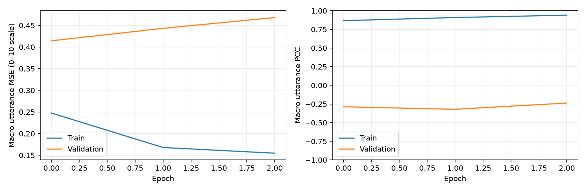

# Phase 3 — WavLM partial fine-tuning

2026-11-03. **실제 원음에서 미분 가능한 상위 2층 학습과 로컬 CPU correctness 검증 완료. GPU 전체 학습은 미실행.**

시작은 [한국어 실행 안내](../../docs/PHASE3_GUIDE.md), 노트북은 [Phase3_Partial_WavLM.ipynb](../../notebooks/Phase3_Partial_WavLM.ipynb)이다. 실험 조건은 [protocol.json](protocol.json)에 고정했다. 아래 수치는 실제 저장된 파일에서 가져왔다.

## 기존 결과 감사

기존 `reports/phase2/`와 `runs/ssl/` 및 사용자의 Phase 2 노트북을 읽어 확인했다. 기존 파일을 수정하지 않았다. 앙상블은 노트북에서 계산된 결과이므로 저장된 seed별 예측의 ID/정답/화자 일치를 확인한 뒤 다시 계산했다. 모든 표는 **동일한 개발용 Validation 500개, 문장 단위 네 점수의 macro 평균**이다.

| Phase 2 조건 | Seed | Validation macro MSE | macro PCC |
|---|---:|---:|---:|
| hidden=32, dropout=.2 | 7 | 1.498601 | 이 표에서는 생략 |
| hidden=32, dropout=.2 | 19 | 1.482258 | 이 표에서는 생략 |
| hidden=32, dropout=.2 | 42 | 1.397159 | 이 표에서는 생략 |
| hidden=128, dropout=.5 | 7 | 1.418000 | .791178 |
| hidden=128, dropout=.5 | 19 | 1.361699 | .795412 |
| hidden=128, dropout=.5 | 42 | 1.340961 | .810207 |
| 위 dropout=.5 세 seed 동일가중 예측 앙상블 | 7/19/42 | **1.322835** | **.807808** |
| 보존된 GOPT Baseline 01 | — | **1.396464** | **.806432** |

hidden=32는 seed별 동일 집계값을 갖는 두 실행 세트가 존재한다. 이를 6개 독립 seed로 세지 않았다. 앙상블−GOPT MSE 차이 **−.0736295**, paired speaker bootstrap 3,000회(seed 20261102)의 95% 구간은 **[−.460153, .336210]**이다. 차이 구간이 0을 포함하므로 우위가 확정된 것은 아니다. 목표별 MSE/MAE/PCC와 source checkpoint hash는 [phase2-audit.json](phase2-audit.json)에 있다. 새 공식 Test 평가는 하지 않았다.

## 구현

- WavLM Base+ revision `4c66d4806a428f2e922ccfa1a962776e232d487b`, 원음 → 12층 hidden states → 유효 frame 평균/표준편차 → 층 혼합/MLP → 네 점수.
- 기본 상위 2층 학습, 상위 1층/전체 고정 모드. head hidden=128/dropout=.5. 실제 CNN/Transformer 경로에 고정 특징 캐시나 inference mode를 사용하지 않는다.
- raw padding을 CNN 이전에 제거한 뒤 latent frame mask를 적용한다. 동적 길이와 padding 값 무시를 단일/배치 수치 대조로 검증했다.
- seed 7 Phase 2 head와 원래 Training 2,000개 기반 정규화 warm-start. 새 head/Training-only 정규화 모드도 제공한다.
- 별도 인코더/head LR, AdamW, 실제 누적 샘플 수에 따른 gradient accumulation, clipping, ReduceLROnPlateau, early stopping, CUDA AMP 선택 경로.
- 전체 모델·정규화·설정·데이터 식별자·환경·optimizer/scheduler/scaler·난수 상태 checkpoint, checksum, 출처 검사, 별도 run 재개, 예측 재생성.

## Stage A — 실제 WavLM과 WAV 2개

| 확인 항목 | 실측 |
|---|---:|
| 공식 단일 forward 대비 pooling 최대 절대 오차 | 1.1921e-7 |
| batch와 개별 입력 pooling 최대 절대 오차 | 4.7684e-7 |
| padding 위치의 값을 1000으로 변경한 영향 | 없음 |
| pooled shape | 2 × 12 × 1536 |
| 상위 2층 trainable 파라미터 | 14,176,808 |
| head trainable 파라미터 | 197,264 |
| encoder gradient norm | .0249640, finite |
| 10층 / 11층 optimizer 후 변화 L2 | .0251827 / .0256845 |
| frozen gradient / frozen 가중치 SHA 변경 | 0 / 없음 |

원본 증거: [stage-a.json](stage-a.json). top 0/1/2 모드의 gradient 정책은 작은 무작위 backbone 단위 테스트에서도 확인했다. **실제 pretrained 대조와 소규모 학습은 top 2를 사용했다.** 새 head 통계가 Validation을 읽지 않는 것도 단위 테스트로 검증했다.

## Stage B — 실제 WAV 20개

원래 분할에서 16 Train/4 Validation, 화자 중복 없이 선택했다. seed 7, top 2, warm-start, fp32, batch 2, accumulation 2, encoder LR 1e-5/head LR 1e-4. warm-start head는 이미 원래 2,000개로 학습된 모델이다. 이 부분집합은 기능 검증용이며 새 일반화 실험이 아니다.

| Epoch | Train macro MSE | Validation macro MSE | Encoder 변화 L2 (연속 run) |
|---:|---:|---:|---:|
| 0 | .247478 | .414404 | 0 |
| 1 | .167858 | .443111 | .102350 |
| 2 | .154784 | .468089 | .142072 |

초기 epoch 0가 best로 유지됐다. Training 오차는 감소했지만 작은 Validation 오차는 증가했다. **fine-tuning 성능 개선이 입증된 결과는 아니다.** 검증 4개의 PCC는 표본이 작아 해석하지 않는다. 목표별 MSE/MAE/PCC는 [epoch 1](initial/metrics-001.json), [epoch 2](continuous/metrics-002.json)에 투명하게 공개한다.

원래 1 epoch run: `runs/phase3/20261102-172648-542194`.
재개 run: `runs/phase3/20261103-090743-101198`.
연속 2 epoch run: `runs/phase3/20261103-090843-541144`.

모델은 각 로컬 run의 `last.pt`에 있고, best는 epoch 0다. 공개 폴더에는 모델 가중치·원음·개별 예측이 없으며 집계와 그림만 있다.

## 복원·재개·테스트

- 실제 Jupyter kernel에서 원래 노트북의 10개 코드 셀 실행, 오류 없음.
- 완전히 새 kernel에서 환경/복원/대조 3개 셀 실행. 재학습 없이 원래 저장된 예측과 **비트 단위 일치**.
- 1 epoch checkpoint에서 두 번째 epoch로 재개한 모델과 중단 없이 2 epoch 학습한 모델을 대조했다. **모델 255개 tensor, optimizer, scheduler, scaler, CPU/Python RNG, 분할 및 예측 모두 정확히 일치**했다. [재개 대조 결과](resume-verification.json).
- 기존 94개와 Phase 3 신규 9개, **103개 테스트 통과**. provenance 불일치, 파일 변조, Validation 통계 누출, accumulation 마지막 불완전 batch, padding, frozen/trainable 상태 등을 포함한다.
- [보존 감사](preservation.json)는 기존 6,781개 파일의 사전 SHA와 사후 SHA를 대조한다. checkpoint·캐시·데이터·사용자 수정 기존 노트북을 포함한다.
- 실행 노트북/테스트 로그/checkpoint SHA는 [verification.json](verification.json)에 기록했다. 실행 노트북은 오디오 출력이 있어 공개 Git에 포함하지 않는다.

## 실제 자원

Python 3.11.4 / PyTorch 2.15.0+cpu / Transformers 4.57.6, Windows, RAM 약 16 GB. CUDA 사용 없음.

| 실행 | 경과 시간 | CPU 시간 | 관측 peak RSS |
|---|---:|---:|---:|
| Stage A (모델 로딩·대조·backward) | 115.25 s | 104.83 s | .947 GiB |
| 초기 1 epoch run | 68.36 s | 240.53 s | 1.105 GiB |
| 저장 상태에서 epoch 2 재개 | 30.77 s | 94.89 s | 1.475 GiB |
| 연속 2 epoch run | 63.49 s | 218.41 s | 1.060 GiB |

시간은 각 모니터 범위이며 전체 Jupyter 시작 시간은 아니다. 초기 로딩/파일 캐시 상태가 달라 실행 사이의 속도 차이를 학습 효율 향상으로 해석하지 않는다. GPU VRAM/속도/비용 실측은 없다. 이번 유료 GPU/API 지출은 **$0**.

## 남은 단계와 리스크

1. 승인된 NVIDIA 환경에서 64개 실제 WAV pilot의 시간·VRAM·gradient·복원 동작 확인. 그 후 비용 추정과 전체 실행 승인.
2. 같은 초기화에서 top 2와 top 0을 원래 Training 2,000/Validation 500으로 비교. 기본 max 10 epoch/patience 3.
3. 결과에 따라 seed 7/19/42 반복, paired speaker bootstrap, 평균 예측 baseline, GOPT/Phase 2와 동일 단위 비교. 전체 모델 선정은 Validation macro MSE 유지.
4. 근거가 생긴 뒤 top 1/LR ablation, 시간 정보 보존 및 목표 문장 결합 순서로 확장.

Validation을 반복 사용해 선택 편향이 누적됐다. 공식 Test는 새 튜닝에 쓰지 않는다. GPU AMP/VRAM/속도와 장치 간 복원은 아직 실검증 전이다. HF mask dtype 경고가 발생하지만 현재 단일/배치 수치 대조는 통과했다. 짧은 검증셋의 손실 변화나 높은 Train PCC를 실제 발음 교정 효과로 주장하지 않는다.
